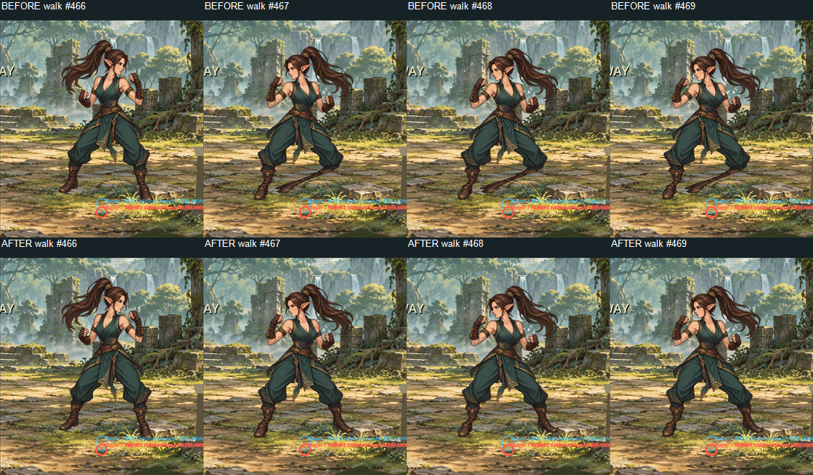
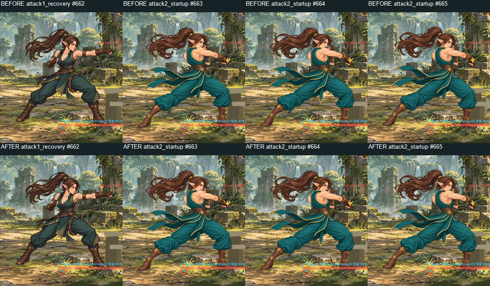

# M6V / WORK 681 HIGH 검토

결론: **BLOCKED**. 증거 저장 결함과 보행 변형의 일부 원인은 수정했다. 그러나 기본 3타의 실제 피해 검사 실패, 의상/자세 전환과 스킬 실루엣의 시각 결함, 사람 승인 부재가 남았다. 아래 AI 이미지 관찰은 사람의 육안 승인이 아니다. 최종 시각 판정은 전부 **UNVERIFIED**다.

## 증거와 비교 방법

- 최초 작업 폴더의 PNG, 보고서, 캡처/스모크 소스, 보정 전 body mesh를 [체크포인트](m6v_high_checkpoint/)에 복사했다. [SHA-256](m6v_high_checkpoint/sha256.csv)으로 원본 바이트를 확인할 수 있다. 이전에 있던 M6Q 변경은 이번 HIGH에서 수정하지 않았다.
- 수정 전 실제 입력 원본: [before_isolated](../../assets/art/review/m6v_high_before_isolated/). 수정 후: [after_final](../../assets/art/review/m6v_high_after_final/). 각각 **518장**, 560×600, 같은 카메라 zoom 1.0, 같은 입력 순서와 60Hz 고정 시뮬레이션이다. 실제 Player physics와 InputMap을 사용하며, 무작위 적 간섭을 제거하기 위해 다른 액터의 process_mode를 DISABLED로 하고 멀리 옮긴 격리 시험이다. 자유 플레이나 사람 입력 녹화가 아니다.
- before_isolated는 소스 수정 전에 실제 수집한 원본이다. 당시 썸네일 GPU 재렌더의 엄격한 픽셀 일치 검사가 실패하여 캡처 프로세스 exit 1을 기록했다. 원본 518장과 telemetry는 끝까지 저장되었으며 별도로 크기·연속 프레임 번호·해시를 검증했다. 전후 보드는 이 원본 PNG를 직접 사용한다. 실패한 썸네일 비교를 PASS로 바꾸지 않았다. 최종 합성기는 CPU로 캡처 픽셀을 직접 복사해 이 차이까지 제거했다.
- [전후 보드 44장](../../assets/art/review/m6v_high_comparison/): 21개 상태의 대표 4프레임, 각 상태 진입의 연속 4프레임, 좌/우 회전의 연속 4프레임. 위 BEFORE / 아래 AFTER, 양쪽 모두 원본의 정확한 0.5배(280×300), 종횡비 유지. `transition_` 보드에서는 진입 직전 1장과 직후 3장을 비교한다.
- [프레임 검수표 1,036행](../../assets/art/review/m6v_high_comparison/frame_review.csv): 관절 왜곡, 발 미끄러짐, 손/Shape, 실루엣 중복, 전환 점프, 프레임 끊김, 얼굴·귀·포니테일·복장을 기록했다. AI가 실제 열람한 대표 프레임과 미열람 프레임을 `ai_reviewed`로 구분했다. 모든 human_approval은 UNVERIFIED다. 프레임 전체를 사람이 검수했다고 주장하지 않는다.
- [최종 접촉 시트](../../assets/art/review/m6v_animation_quality_contact_sheet.png)는 실측 **1280×12960, 4열×36행, 141카드(강제 94 / 실입력 47)**다. 최종 기록 891표본은 강제 373 + 실제 입력 518이다. 시트의 300×302 썸네일은 역사적 규격을 유지해 비등방 축소된다. 세밀한 외형 판정에는 원본이나 종횡비 유지 전후 보드를 사용한다.
- [원본 무결성 목록](m6v_high_results/raw_integrity.csv)과 [최종 manifest](../../assets/art/review/m6v_animation_quality_contact_sheet.png.json)에 PNG 해시, 상태, 프레임 번호가 있다. 고정 60Hz의 누적 visual t는 실제 경과 시간과 같다는 의미가 아니다. wall/monotonic 시각은 별도 telemetry다.
- 점프 정점의 머리와 KO 끝부분은 역사적 crop 밖으로 나간다. [전체 Window 보조 캡처 34장](../../assets/art/review/m6v_full_reactions/manifest.json)을 1920×1080, zoom 1.0으로 추가했다. 6프레임 간격의 수정 후 보조 표본이며, 연속 전후 비교나 F10 자료를 대신하지 않는다.

## 수정한 원인과 확인 결과

1. 기존 도구는 OS Window에 10,000px 이상의 높이를 요청하고 root texture를 그대로 저장했다. fullscreen/stretch 설정으로 실제 저장은 1280×720이었다. 이제 1280×720 SubViewport 페이지를 CPU Image에 합성한다. 저장 PNG를 재로딩하고 치수·카드 수·각 카드 픽셀을 검사한다. 보고서 치수는 재로딩 결과다.
2. 스모크의 `width>=1280 && height>=720`을 정확한 4열 그리드, 카드 수, 카드별 픽셀 SHA-256, 원본 PNG 해시/560×600 치수, 연속 Window frame 검사로 바꿨다. 새 상태 이름만 찾는 검사를 넘어서 실제 이미지 내용과 매핑을 검사한다. 원래 1280×720 PNG를 넣은 음성 시험은 의도대로 exit 1이었다.
3. `player_body_mesh.gd`의 지지발 보정은 발끝에서도 가중치가 1이 되지 않고 종아리 아래에 집중되어, 원본 #410 부츠 늘어짐과 #467–469 좌향 반전 뒤 길고 가는 다리 변형을 만들었다. 현재 렌더 삼각형의 보간값을 기준으로 보정량을 풀고, 무릎·종아리·부츠가 함께 이동하도록 넓게 분배했다. 반전 시 이전 방향의 접지점을 해제한다.
4. `max(0, sin(stride))` 때문에 반대쪽 스윙에서는 다리 들기가 사라졌다. `abs(sin(stride))`로 양쪽에 적용하고 지지 다리 hip/knee 선택을 바로잡았다. 원화/UV/승인 registry는 바꾸지 않았다.

같은 518프레임 입력 비교에서 최대 지지점 잔차는 **15.585 → 0.007px**, 최대 프레임 위치 이동 **12.667px**, 활성 손/Shape 중심 오차 **0.000px**, 전신 source 최대 **1**이었다. 별도 이동/반전 회귀에서는 잔차 0.00684px, 종아리–발목 표본 구간 최대 길이 비율 1.0000배였다. 이는 표본 좌표 계약의 확인이지 전체 발바닥 접지나 자연스러운 보행의 승인 아니다.

## AI 이미지 관찰과 남은 시각 결함

21개 상태 대표 보드 전부와 J1→J2, J2→J3, 좌향 반전 연속 보드, 선택 원본, 전체 Window 점프/KO를 직접 열람했다. 아래 관찰의 상태별 메모는 검수 CSV에도 있다. 기타 전환 보드와 나머지 원본은 사람 검수 자료로 남긴다.

| 항목 | 이미지 관찰 / 코드 대응 | 사람 판정 |
|---|---|---|
| 얼굴·귀·포니테일·복장 | 보행 수정 전후에 얼굴·귀가 새로 찌그러지는 변화는 선택 프레임에서 보이지 않음. 그러나 J1→J2 #662→663에서 청록 채도, 허리 장식, 어깨 윤곽이 즉시 바뀜. `player_animation_bank.gd`의 기존 서로 다른 contact 원화 전환과 대응. 새 미승인 원화를 승격하지 않음 | UNVERIFIED |
| 팔꿈치·무릎 | #467–469의 반전 후 가늘게 접힌 다리는 수정 후 감소. J1 startup/recovery에서도 팔을 뻗은 원화를 유지해 접기/회수 표현은 부족. 무릎과 허벅지의 전 구간 형태는 승인 필요 | UNVERIFIED |
| 지지발·보폭·골반 | 지지점/부츠 길이 보정 확인. 골반 상승 계측 11.02 source px. 넓은 전투 자세를 변형하는 보행이어서 실제 보폭·무게중심 자연스러움은 여전히 불충분할 수 있음 | UNVERIFIED |
| 좌/우 회전 | 접지점 오염으로 생긴 다리 변형 감소. 원화가 한 프레임에 좌우 반전되는 표현은 남음; 뒤돌기 중간 원화를 제공했다는 의미가 아님 | UNVERIFIED |
| 점프·착지 | InputMap 상승→하강→착지 확인. 전체 Window #031에서 머리/귀/포니테일 포함 전신 확인. 기본 가드 자세의 상하 이동과 squash 위주여서 다리 접기·착지 무게 흡수는 부족 | UNVERIFIED |
| 피격·KO | damage API로 실제 HP 5→4→0과 상태 전이. 피격은 가드 자세의 작은 뒤틀림, KO는 같은 가드 원화가 통째로 회전함. 전체 Window #145/#174에서 팔/다리가 가드 상태인 채 쓰러지는 문제 확인. `player_visual_animator.gd`의 temporary KO rotation/scale 경로와 대응 | UNVERIFIED |
| 기본 3타 연결 | #662→663 및 #688→689에서 손/머리 위치와 의상이 한 프레임에 크게 변함. 전신 중복은 선택 프레임에서 보이지 않지만 중간 자세·체중 이동이 부족. J3 combo_hold는 설계상 N/A | UNVERIFIED / J3 hold N/A |
| Num4 돌진 | 실제 이동과 청록 VFX는 확인. 팔은 가드에 가까워 몸만으로 돌진 타격을 읽기 어려움. 승인된 전용 연속 원화 대신 temporary pose/국소 변형 경로 사용 | UNVERIFIED |
| Num5 백피스트 | 보라 VFX와 몸 기울기 변화는 확인. 팔/등 회전과 백피스트 실루엣은 충분히 드러나지 않음. 모션 source 교체 없이 VFX만으로 최종 PASS할 수 없음 | UNVERIFIED |
| 손/Shape·중복·순간 점프·끊김 | 활성 중심 오차 0, source 최대 1, 프레임 번호 연속은 기계 검사 통과. 휴먼 형태 판단 및 MP4 기준 영상 대조는 별도 미완료 | UNVERIFIED |

## 실제 피해 계약: 부분 행사, 실패 있음

기존 `m6s_real_combat_damage_window_smoke.gd`를 독립 Window에서 실행했다. Player는 InputMap/physics를 사용하지만 상대 AI는 정지시킨 120px 간격 fixture이며 Raider HP는 시험용 20이다. 상대 receive_hit를 시험이 직접 호출하여 HP를 낮춘 결과가 아니다. 플레이어의 실제 Shape query→피해 경로다.

| 상대 | J1–J3 합계(기대 6) | Num4(기대 3) | Num5(기대 2) |
|---|---:|---:|---:|
| Raider | 20→18, **2 / FAIL** | 20→17, 3 | 20→18, 2 |
| 활성 Boss | 20→18, **2 / FAIL** | 20→17, 3 | 20→18, 2 |

전체 실행은 J1/J2 누적·3타 합계/횟수·좌향 기본 공격 등 **10개 실패, exit 1**. 고정 FPS 옵션을 뺀 normal-only 재검증에서도 양쪽 J123 20→18이 재현되며 **8개 실패, exit 1**이다. 따라서 타이밍 옵션 때문이라고 종결하지 않는다. 공격/피해 코드와 승인 원화는 이번 HIGH에서 바꾸지 않았지만, 기본타 계약의 보존을 PASS라고 선언할 근거도 없다. 원인 확정과 정상 거리·좌향 적중 보정이 후속 필수다. Num4/5의 실제 HP 감소 증거는 확보했으나, 살아 있는 적 AI와의 전체 전투 및 기준 MP4 대조를 완료했다는 주장은 하지 않는다.

## 실행 검증

Godot 4.7.2.stable.mono, OpenGL Compatibility, 실제 Window. 아래 출력은 [보존 로그](m6v_high_results/)에 있다.

| 검사 | 결과 |
|---|---|
| 최종 캡처 | exit 0, 141카드/891표본/실입력 PNG 518장 |
| M6V 매트릭스 | exit 0, 98개 PASS; 시각 승인 추론 없음 |
| 원본 잘린 시트 음성 시험 | 예상 exit 1, 정확 치수 검사에서 차단 |
| 최종 artifact-only | exit 0 |
| M6V body deformation + 이동/반전 추가 회귀 | exit 0, 종아리/부츠 길이·지지점 검사 포함 |
| M6U actual motion | exit 0, 370 render frames, 4 gait phases, support 0.007px, mesh edge 125.10 source px, physics gap 1 |
| 전체 Window 반응 보조 캡처 | exit 0, 34장 |
| 실제 피해 full / realtime normal-only | exit 1 / exit 1, 위 실패를 미해결로 유지 |
| 전후 원본 무결성 | PNG 1,036장 치수/연속 프레임 번호/해시 검증 |

시스템 인증서 저장소 경고는 있었으나 캡처/이미지 검사 실패 원인으로 관측되지 않았다. 로그/결과를 누락시키거나 실패를 PASS로 바꾸지 않았다. Git commit/push/reset/rebase와 .git 수정은 수행하지 않았다.
